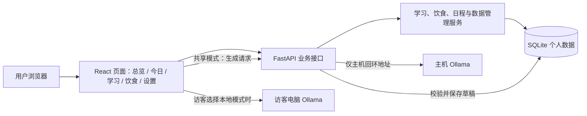

# PersonalHub——融合学习、饮食与大模型辅助规划的个人生活管理系统

> 程序设计课程设计 · 开题报告
>
> 学生姓名：________　专业班级：________　指导教师：________
>
> 撰写日期：2026 年 10 月

## 摘要

PersonalHub 是一个面向个人的网页式计划管理系统，以统一日程为中心，把学习目标、每日任务、专注计时和饮食安排放在同一工作空间中，并通过首页总览与今日计划完成跨页面聚合。用户既可以在自己的 Windows 电脑上独立运行，也可以通过共享网页注册个人账号；学习计划与周期饮食可手工制定，或由大模型生成可编辑草稿后再确认导入。系统提供主机共享模型和访客本机模型两种选择，避免把模型安装作为使用其他功能的前提。

本课题以现有可运行原型为基础，研究多类计划如何按日期关联、修改或删除后如何在各页面保持一致，以及 AI 生成内容如何经过校验和人工确认才进入正式数据。课程设计将围绕业务流程、数据安全、模型接入和测试验证完善系统，形成可运行程序、部署说明与测试记录。

**关键词：**个人计划管理；统一日程；学习计划；饮食日历；专注计时；Ollama；数据隔离；Web 应用

## 一、课题缘起与项目定位

个人安排常分散在日历、备忘录、学习清单和饮食记录中。例如，制定了一周的英语复习计划后，还要把每天的任务逐条放进日程；修改学习日期或删除某餐饮食安排时，首页、今日计划和原计划页面也需要同步变化。仅仅把几个模块放到同一网页，并不能解决重复录入与信息不一致的问题。

PersonalHub 的目标是让用户沿着“制定计划—查看当天安排—记录执行—调整计划”的路径完成管理。学习与饮食是两类核心业务，今日计划是按日期聚合后的执行入口，首页提供概览，数据与设置负责个性化、模型选择、备份和恢复。AI 只负责辅助形成学习计划草稿和饮食模板草稿，正式计划由用户检查、修改并确认。

本项目不训练大模型，也不把 AI 生成结果视为必然正确的学习建议。饮食模块用于安排餐次、估算热量和整理采购信息，不提供疾病诊断或精确营养处方。共享网页当前通过临时 HTTPS 隧道开放，适合演示与试用；固定域名和长期在线服务不属于现有原型已经实现的能力。

## 二、现有原型与本次研究范围

现有原型已经具备 React 前端、Python（FastAPI）后端和 SQLite 数据存储，当前网页保留“首页总览、今日计划、学习计划、饮食计划、数据与设置”五个主页面，并把专注计时嵌入学习流程。课程设计不从空白界面重新开始，而是在已有功能上梳理数据关系、完善异常处理，并用可重复的测试证明跨页面行为正确。

| 页面或能力 | 现有原型提供的主要操作 | 本课题重点验证或完善的内容 |
| --- | --- | --- |
| 首页总览 | 展示当天任务数量与完成情况、待办与学习/饮食摘要、快速创建入口、便签与日终回顾 | 汇总数据与原始记录一致，删除或改期后不再展示旧内容 |
| 今日计划 | 按日期聚合全部来源任务；完成、取消、改期、排序任务；快速记便签、写日终回顾 | 不同来源任务按同一日期口径呈现，状态变化可追踪 |
| 学习计划 | 管理学习目标、学习阶段、每日任务、学习记录与参考资源；阶段信息合并在每日任务中，支持勾选完成、按日追加任务、手动进度与自动延期 | 删除某日任务后日期仍可保留并重新添加；目标与任务关联、进度统计、跨页同步及 AI 草稿导入 |
| 专注计时 | 为学习目标或任务启动番茄式专注会话，可调整时长、停止、清零重计，并统计每日专注时间 | 专注时长与学习记录一致，中断、重置与完成路径都可校验 |
| 饮食计划 | 月历查看早/午/晚/加餐；管理菜品与食材、一餐多菜、卡路里、饮水体重日志、可编辑购物清单、饮食模板与 AI 菜谱草稿 | 日期切换、餐次增删改、卡路里与购物清单按食材聚合，日历与首页/今日同步 |
| 数据与设置 | 个性化外观主题、全局搜索、备份恢复、回收站、模型选择（共享/本机）、共享账号注册登录 | 数据恢复可靠性、本机与共享模式的配置和权限边界 |

系统有两种运行形态。**本机版**只监听本机地址，正式数据存入使用者电脑上的 SQLite 文件，无需注册账号。**共享版**运行在主机上的独立服务中，访客注册后使用自己的数据空间；它与主人的本机数据库分开。访客打开网页即可使用计划功能和主机提供的共享模型；如果访客电脑安装了 Ollama，也可以自行选择本机模型。两种形态共用主要业务界面，但数据位置、身份校验和模型请求路径不同。

### 2.1 新增功能介绍

在原有个人计划管理功能的基础上，当前版本补充了下列功能，使系统从“记录信息”进一步发展为“辅助制定计划、跟踪执行并支持多人体验”的完整工具。

| 新增功能 | 用户怎样使用 | 功能说明与实际价值 |
| --- | --- | --- |
| AI 学习计划生成 | 填写学习主题、目标、当前基础、开始日期、计划天数和每天可用时间，生成后先预览和编辑，再确认导入 | 支持生成 1—30 天的学习草稿。系统会检查日期、章节引用和每日总时长，错误内容不会直接写入正式计划，降低模型回答不完整造成的影响 |
| 学习阶段与每日任务合并 | 每个任务卡片同时显示所属学习阶段、任务详情、预计时长和完成状态，可在卡片内修改阶段或任务 | 页面不再把“学习阶段”和“每日任务”拆成两套重复列表，用户可以直接理解某天要完成哪个阶段的什么内容 |
| 按日期追加学习任务 | 每个日期标题后显示“＋”，点击后自动带入该日期；同一天可以继续添加多项任务 | 删除某日唯一任务后，计划起止范围内的日期仍会保留为空白日，用户可以重新补回任务，解决日期随任务一起消失的问题 |
| 学习任务自动顺延 | 打开学习计划页时，系统检查已到期且连续三个自然日未完成的任务；满足条件后，将剩余任务整体顺延并显示提醒 | “自动顺延”是把未完成任务的日期向后移动，让最早一项回到当天；已完成任务保持不变，首页和今日计划同步更新 |
| 学习任务与专注计时联动 | 从学习目标或任务开始专注，可调整本次时长、提前结束或清零重新计时，结束后保存实际学习时长 | 刷新页面后可以恢复正在进行的计时，并统计当天累计专注时间，使学习执行情况可以量化 |
| 饮食热量估算 | 在餐食中填写热量，或通过常用菜品、食材和份量得到估算值 | 系统优先采用用户手动填写的 kcal，其次使用菜品预设值，再按可识别食材估算。结果用于日常记录参考，不作为医疗或精确营养建议 |
| 一餐多菜与常用菜品维护 | 安排一餐时可同时选择多个常用菜品；常用菜品可修改名称、做法和用料 | 一顿饭不再只能绑定一个菜品，修改菜谱后可继续用于后续餐次，减少重复录入 |
| 饮食模板与 AI 菜谱 | 使用减脂餐、备考周、养胃清淡等示例模板，也可让模型生成最多七天的菜谱；编辑草稿后保存为模板或导入日历 | 周期模板可按设定天数循环导入，并跳过同一天同一餐次已有的安排，避免覆盖原记录；食材还能汇总为购物清单 |
| 可编辑购物清单 | 按当前月份饮食自动汇总食材，也可新建空清单、手动添加、修改、勾选或删除购物项目 | 自动生成和人工补充共用同一清单，用户可按实际采购情况调整名称与数量 |
| 主题颜色与深色模式 | 在个性化设置中选择主题色并切换深色模式，保存后在各页面统一应用 | 主题设置持久化保存，使共享版与本机版都能保持用户自己的视觉偏好 |
| 多人共享网页与账号隔离 | 主机启动独立共享服务，访客通过 HTTPS 网页注册登录后使用自己的学习、饮食、设置和备份空间 | 每个账号的数据彼此隔离，并与主人的本机数据库分开。共享网页适合课堂演示和短期试用，当前临时网址在隧道重启后可能变化 |
| 共享模型与访客本机模型切换 | 访客可直接使用主机提供的共享模型，也可在设置中连接自己电脑上的 Ollama | “共享模型”由主机计算，访客无需安装模型；“本机模型”在访客自己的电脑上运行，不占用共享模型次数。两种模式只影响生成步骤，不影响手工计划功能 |
| Windows 打包、备份与恢复 | 双击打包后的程序启动本机版，在设置页创建备份、恢复数据或管理回收站 | 正式数据保存在独立 SQLite 文件中；恢复备份前先保存当前数据库，减少误覆盖风险，便于课程验收和换机迁移 |

这些新增功能采用统一的处理原则：AI 内容先形成草稿，用户确认后才进入正式数据；学习与饮食记录通过统一日程同步到首页和今日计划；本机版、共享版及不同共享账号使用清晰的数据边界。即使没有安装 Ollama，用户仍可正常使用所有手工管理功能。

## 三、典型使用流程与需求约束

### 3.1 从目标到每日执行

用户建立“英语六级复习”目标，设定开始日期、目标日期和每天可用时间，再为每天安排带阶段说明、任务详情与预计时长的任务。学习阶段直接显示在对应的每日任务卡片中；同一日期可添加多项任务，删除某日唯一任务后仍可通过日期旁的“＋”重新添加。到当天时，任务出现在“今日计划”和首页；勾选完成后，学习页面中的状态与进度随之更新。若用户修改日期，聚合结果应移动到新日期；若删除任务或整个学习目标，其他页面不能继续展示已删除内容。

### 3.2 从饮食月历到实际记录

用户在月历中选择日期和餐次，可一次选择多个常用菜品，也可填写自定义餐食并调整估算热量。月历应区分不同日期和餐次，支持跨月浏览、修改和删除。删除某餐后，日历格、当天摘要、今日计划及搜索结果需要使用同一删除状态，避免出现“计划页已删、首页仍在”的矛盾。常用菜品的做法和用料可以修改，食材可用于按当前月份自动生成购物清单；清单项目还可手动添加、修改、勾选或删除。饮水、体重和感受作为独立的日常记录保存。

### 3.3 AI 辅助生成而非自动决定

用户输入学习主题、目标、基础、起始日期、计划天数和每日可用分钟数。模型生成结果先作为草稿展示，用户可以修改计划名称、章节、任务标题、日期、时长和说明，也可以移除任务。只有点击确认，系统才将草稿转为正式学习目标、章节和任务。若模型未完整覆盖天数、引用不存在的章节、超出每日时长或返回不完整内容，应明确报错，并且不写入正式计划。

需求上还应满足：页面在模型离线或繁忙时给出可理解的状态；取消等待不应误导入计划；无模型的用户仍可手工使用学习、饮食和日程功能；不同共享账号不能互相读取计划、备份或草稿。

## 四、系统方案与技术组织

### 4.1 分层结构

前端使用 React、TypeScript、Vite 与 Ant Design 构建交互页面；后端使用 FastAPI 提供接口，SQLAlchemy 管理 SQLite 数据。浏览器不直接修改数据库，所有正式记录经过后端输入校验和业务处理。本机版与共享版复用主要业务接口，运行入口和数据根目录分别配置。

图中访客本机模型的请求由访客浏览器发往自己电脑的回环地址，不经网站主机转发；网页会接收模型输出并交给后端校验、保存草稿。共享模型则由主机后端访问主机 Ollama，因此访客电脑无需安装模型。主机 Ollama 和两套网页服务都保持本机监听，共享版由 HTTPS 隧道转发网页请求，不直接开放 Ollama 端口。

### 4.2 核心数据与关联

| 数据对象 | 主要字段或内容 | 与其他模块的关系 |
| --- | --- | --- |
| 学习目标、章节、任务 | 目标名称、期限、章节顺序、任务日期与状态 | 有日期的任务关联日程，在今日计划与首页汇总 |
| AI 学习草稿 | 生成计划内容、草稿编号、是否已导入 | 与正式目标分离，确认导入后记录对应目标，防止重复导入 |
| 饮食安排与菜品 | 日期、餐次、多个菜品或自定义名称、估算热量、食材 | 在月历展示；当天餐次进入相关摘要和日程 |
| 日程条目 | 日期、状态、优先级、来源类型与来源编号 | 作为不同来源计划的每日执行视图 |
| 备份与回收站 | 数据文件、校验信息、删除标记 | 支持恢复与永久清理，保留误操作补救路径 |

关键设计是保留来源编号和删除状态：今日计划是学习任务或饮食安排的视图之一，而不是再复制一份互不相关的文本。对目标、任务或餐次进行修改和删除时，业务层应在同一事务内处理相关日程记录；首页、搜索和日历查询均排除已删除记录。这样才能让“删除后在所有模块中不呈现”成为可检验的数据规则。

### 4.3 各功能模块职责说明

为避免“页面很多但说不清每个模块管什么”，本节按业务边界说明各模块的输入、输出与关联点。

**（1）首页总览与今日计划（聚合层）。** 首页只读取不写入，按当天日期汇总待办数、完成数、学习摘要、饮食摘要与最近便签，并提供快速创建入口。今日计划是唯一按日期聚合的执行视图，统一读取 `agenda_items` 中当天的记录，每条记录通过 `source_type + source_id` 反查到学习任务、饮食安排或其他来源；完成、改期、排序等操作均回写到同一条日程记录及其业务主表。便签 `quick_notes` 可由用户单独记录，也可一键转为任务；日终回顾 `daily_reviews` 按日期唯一，用于写当天总结。

**（2）学习计划。** 以“目标 → 阶段 → 每日任务”三级关系组织一门课程或一项技能，但在交互上把阶段信息直接合并到对应任务卡片，不再展示一套重复的阶段列表。目标记录名称、起止日期、预计投入分钟和可选的手动进度；任务记录标题、详细要求、预计时长、日期、完成状态及所属阶段，并自动挂接一条日程。计划起止范围内的空白日期仍会保留，日期旁的“＋”可预填当天并追加多个任务。学习记录 `study_sessions` 按日期登记实际学习分钟、笔记、遗留问题与下一步；参考资源保存名称、链接与备注。连续三个自然日未完成时，自动延期机制可把剩余任务顺延并显示站内提醒。

**（3）专注计时。** 学习页面内置番茄式计时器，可选择学习目标或具体任务，并手动调整专注分钟数。启动后记录本次经过时间和当天累计专注时间，支持提前结束、清零并重新计时；结束时把实际时长写入专注记录。专注模块不复制计划逻辑，只负责“一次学习投入”的量化记录。

**（4）饮食计划。** 以月历为入口，按“日期 × 餐次（早/午/晚/加餐）”组织安排。菜品库 `dishes` 维护名称、做法、营养备注及其食材清单 `dish_ingredients`，并允许再次修改；一餐可以同时选择多个菜品。卡路里服务根据菜品与食材估算每餐热量并在日历与详情中展示。日常健康日志按日期记录饮水毫升、体重与主观感受。购物清单既能按当前月份饮食自动聚合食材，也支持新建空清单和手动增删改项目；饮食模板用于把常用周期餐次一键套用到某段日期。AI 饮食生成按目标天数、忌口与偏好输出可编辑的菜谱草稿，确认后才写入餐次表。

**（5）系统与数据设置。** 全局搜索跨页面检索标题、正文与备注；回收站对软删除记录提供恢复与永久删除；备份导出包含学习、饮食、日程、AI 草稿与模型设置，恢复前自动保留当前数据副本。个性化设置支持主题颜色和深色模式并持久化保存；模型设置面板区分主机共享 Ollama 与访客本机 Ollama 两种连接方式。

## 五、两种模型模式的实现思路

### 5.1 共享模型

共享版默认使用主机上的 Ollama 模型。用户提交生成需求，服务端检查登录状态和每日次数，再以统一的提示词与结构化输出约束请求模型。同一时间只安排一条共享推理，其他请求在页面自动等待并重试，允许用户取消；尚未进入推理的等待不消耗每日次数。生成成功后，服务端校验草稿并按当前账号保存。

这种方式使“打开网页即可使用 AI”成为可能，但生成速度受主机性能、同时在线人数、网络和主机开机状态影响。网页不能把临时隧道等同于稳定的正式托管服务，课程设计将如实记录这些运行条件。

### 5.2 用户本机模型

共享版访客可以在“数据与设置”中选择本地模式，填写本机 Ollama 服务地址、刷新已安装模型并保存。浏览器直接向 `127.0.0.1` 等回环地址发请求；Ollama 需要允许当前网页来源，浏览器也需要允许本地网络访问。系统限制地址范围，避免用户把任意外部地址作为本地模型服务使用。本机版则由本机后端连接同一电脑的 Ollama。

两种模式复用需求组织、草稿校验和人工确认流程。切换模型只影响生成环节，不改变正式计划的数据结构；模型配置失败不会阻断手工管理功能。

## 六、需要重点解决的工程问题

| 问题 | 处理方式 | 验证重点 |
| --- | --- | --- |
| 跨模块数据容易不同步 | 用来源关联和统一删除规则维护日程，查询时过滤已删除记录 | 修改日期、删除任务或餐次后，各页面结果一致 |
| 小模型输出可能漏天或格式错误 | 约束 JSON 结构、天数、章节引用和分钟数；服务端再次校验 | 错误输出被拒绝，不产生半成品正式计划 |
| 多人共用轻量模型会相互等待 | 限制单次推理、每日次数和等待时间，提供取消与重试反馈 | 繁忙状态不扣次数，空闲后可继续生成 |
| 本机版与共享版容易混用数据 | 不同服务入口和数据根目录；共享账号独立存储并验证会话 | 主人本机数据不被访客读取，账号之间不串数据 |
| 删除和恢复可能造成误操作 | 删除确认、回收站和备份恢复；恢复前保存当前数据 | 取消删除不改变数据，恢复后内容可复核 |
| 网页在不同设备上体验不一致 | 响应式布局、键盘可操作控件、深浅主题与状态提示 | 窄屏和键盘操作完成主要流程，错误可重试 |

本项目的难点不在于把模型回答显示出来，而在于让生成、编辑、正式保存、跨页同步和失败恢复形成完整闭环。因此，模型输出、用户操作与数据库状态必须分别处理，不能用前端暂存状态替代持久化结果。

## 七、成员分工与实施安排

本课程设计由三名同学协作完成，按“前端交互、后端业务与数据、AI 接入与共享部署”三条线分工，每人对自己负责的模块从接口到测试负责到底，并在跨模块事务处共同联调。

| 成员 | 主要职责 | 负责的具体模块与交付物 |
| --- | --- | --- |
| 成员一（前端与交互） | React + TypeScript + AntD 前端全部页面与组件、响应式布局与主题、前端测试 | 首页/今日/学习/饮食/设置等页面布局；专注计时器、饮食月历、全局搜索、快速创建、保存状态反馈等组件；页面加载恢复与空/错误状态；前端组件测试与浏览器流程用例 |
| 成员二（后端业务与数据） | FastAPI 业务接口、SQLAlchemy 数据模型与迁移、日程聚合与软删除事务、后端测试 | 统一日程 `agenda_items` 与便签/日终回顾；学习目标/阶段/任务/学习记录/资源与自动延期；饮食菜品/多菜餐次/健康日志/购物清单/饮食模板/卡路里；回收站、备份恢复与接口测试 |
| 成员三（AI 接入、共享版与部署） | Ollama 两种模式接入、AI 草稿校验与队列、共享账号体系、本机/共享双运行入口、部署文档 | AI 学习生成与 AI 饮食生成的提示词组织、结构化输出校验、草稿表与确认导入；共享模型并发队列与每日次数；共享版注册登录、会话与数据隔离；本机版/共享版启动入口与 HTTPS 隧道说明；部署脚本与测试记录整理 |

三人在以下跨模块环节共同负责：统一日程与各业务表的关联事务、删除/改期后的跨页一致性、本机版与共享版的数据边界、以及最终验收测试。

课程设计按以下相对阶段推进，具体日期可依教学安排填写。已有原型作为基线，每阶段保留对应代码、测试与问题记录。

| 阶段 | 主要工作 | 可检查的产出 |
| --- | --- | --- |
| 第一阶段：需求与基线 | 整理各页面用户流程、字段、删除与统计口径，固定现有运行方式 | 需求清单、数据关系说明、基线演示 |
| 第二阶段：业务一致性 | 完善学习、饮食的编辑、删除、回收站及日程关联，合并学习阶段与每日任务并补齐按日追加入口 | 跨页面一致性用例、修改前后对比记录 |
| 第三阶段：AI 流程 | 验证共享/本机模型切换、结构化草稿、失败处理和并发等待 | 模型接入说明、模拟与真实模型测试记录 |
| 第四阶段：交付验证 | 完成界面检查、数据隔离测试、备份恢复、部署与使用文档 | 测试报告、可运行程序、共享版演示说明 |

验收时优先检查真实业务结果，而不是只检查按钮能否点击：

1. **计划联动：**新建、改期、完成和删除学习任务后，学习页、今日计划、首页和搜索显示一致；删除饮食安排后，日历与相关汇总均不再出现该餐。
2. **AI 安全导入：**有效结果可编辑并一次性确认导入；超时、无效 JSON、缺天和超时长结果不创建正式计划；重复确认同一草稿不产生重复目标。
3. **运行边界：**无 Ollama 时手工功能照常运行；共享模式无需访客安装模型；本地模式只访问访客电脑的回环地址；共享模型繁忙时可以等待或取消。
4. **数据可靠性：**不同账号的计划、草稿和备份互不可见；备份可校验与恢复，恢复前保留当前版本；刷新或重启后正式记录仍存在。
5. **交互质量：**桌面与窄屏布局可读，键盘能够到达主要操作，加载、空状态和失败原因有明确反馈。

后端采用自动化接口和业务测试，前端采用组件测试与浏览器流程测试；模型异常可由模拟服务稳定复现，真实 Ollama 测试单独记录设备、模型版本和耗时。测试结论以实际运行记录为准，不预先填写性能提升幅度或模型生成成功率。

## 八、预期成果与项目特点

预期交付一个可在 Windows 本机运行、并能以独立账号模式供他人访问的 PersonalHub 网页应用，附带源码、数据库与备份说明、模型配置步骤、部署脚本和测试记录。系统应完整展示“手工或 AI 制定计划—按日执行—修改与删除—汇总与恢复”的流程。

项目的特点是以学习、饮食等具体计划为中心，通过统一日程把不同来源的事项聚合到今日视图；AI 生成结果先进入可编辑草稿，再由用户确认；同一网页提供主机共享模型与用户本机模型两条可选择的接入路径；本机私人空间与共享账号空间保持独立。最终报告将对功能、局限和测试证据分别说明，避免把临时公网演示误写成已经完成的长期云部署。
