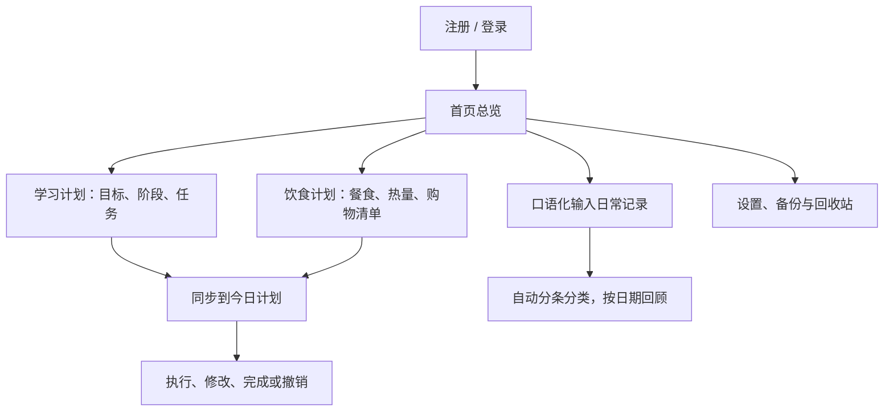

# PersonalHub

一个管理学习、饮食和日常生活的网页应用，把计划、执行和回顾放在同一个工作空间中。

## 核心功能

| 模块 | 主要功能 |
| --- | --- |
| 首页总览 | 查看今日事项、完成进度和快速备忘。 |
| 今日计划 | 按必要程度安排事项，支持编辑、删除、移到明天，以及完成和撤销完成。 |
| 学习计划 | 将目标拆分为阶段与任务；支持阶段编辑、专注计时和 AI 生成学习草稿。 |
| 饮食计划 | 饮食日历、多菜品热量合计、菜品搜索补全、饮食模板、购物清单和饮水记录。 |
| 日常记录 | 口语化描述当天活动，自动分条并按学习、饮食、运动等归类，可查看历史日期。 |
| 数据与设置 | 独立账号、全站深色模式、模型切换、备份恢复，以及按类别或逐条恢复回收站内容。 |

饮食库包含 **2213 条食物数据、250 道参考配方**，支持克数和份数；热量可按实际食材与用量调整。

## 使用流程

## AI 辅助生成

根据目标、基础、可用时间和补充要求生成学习计划，或根据饮食偏好生成菜单。草稿先预览、修改，再确认保存或导入。

完整 Windows 本机版自带 **Ollama + qwen2.5:1.5b**，可离线生成学习与饮食计划；也可在设置中切换到其他已下载的本机 Ollama 模型。

## 下载使用

在 [Releases 发布页](https://github.com/lxl0202-rgb/PersonalHub/releases/latest) 下载附件 **PersonalHub-Full-Windows-20261106-v3.zip**（约 1.09 GB，Windows 10/11 64 位）。

1. 完整解压后，双击 `PersonalHub/PersonalHub.exe`。
2. 浏览器自动打开，注册或登录后开始使用。
3. 升级前先关闭旧版程序窗口，再启动新版。

软件包包含运行环境和内置模型。账号与数据保存在使用者电脑，不同电脑之间不会自动同步。

## 技术与文档

React + TypeScript + Ant Design · FastAPI + SQLAlchemy + SQLite · Ollama

- [开发、运行与测试](docs/DEVELOPMENT.md)
- [完整本机版使用说明](docs/FullDesktopGuide.txt)
- [数据模型](docs/DATA_MODEL.md) · [接口说明](docs/API.md)
- [测试用例](docs/TEST_CASES.md) · [热量估算说明](docs/calorie-estimates.md)
