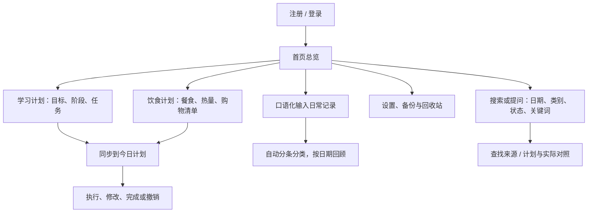

# PersonalHub

## 微信小程序分支

本分支包含微信小程序源码，位于 [personalhub-miniprogram](personalhub-miniprogram/README.md)。使用微信开发者工具导入该目录，并在 `config.js` 中配置后端地址。本地调试代理位于 `_tools/proxy.js`。

网页版与本机软件的说明见下文。

一个管理学习、饮食和日常生活的网页应用，把计划、执行和回顾放在同一个工作空间中。

## 核心功能

### 首页总览

- **今日概况**：展示当天事项数量、已完成数量、必须完成事项和完成率。
- **计划汇总**：集中查看当天的学习任务和饮食安排，点击摘要进入对应模块。
- **完成状态**：可直接勾选完成，再次点击即可恢复未完成，并与今日计划同步。
- **快速备忘**：随手记录想法，支持修改、删除，以及一键加入今天的计划。
- **日常回顾**：在首页录入当天实际做过的事情，并按日期查看整理后的记录。

### 今日计划

- **按日安排**：选择日期查看事项，支持新增计划、修改内容、调整日期和填写备注。
- **分类与优先级**：按“必须完成、按时间安排、有空再做”分组，并设置优先级。
- **关联来源计划**：学习任务和饮食安排同步到今日计划，可调整它们的必要程度，或进入来源模块编辑。
- **进度管理**：事项可标记完成、撤销完成；已完成事项单独展示。
- **重新安排**：可将单条事项移到明天；“结束今日”时可填写总结，并将未完成事项统一移到明天。
- **删除与恢复**：手动添加的计划可删除，误删后可在回收站恢复。

### 学习计划

- **目标管理**：创建学习主题，填写目标、开始日期、计划完成日期和预计投入时间。
- **阶段拆分**：按章节或阶段组织任务；可新增、重命名阶段，也可修改任务的所属阶段。
- **任务编辑**：为任务设置具体内容、执行说明、预计分钟和计划日期，支持逐条修改、删除和完成状态切换。
- **进度展示**：查看目标进度，支持按阶段计算或手动调整百分比。
- **专注计时**：设置专注时长，关联整个学习目标或某条任务，结束时计入实际学习时间。
- **学习记录与资料**：记录实际学习分钟、笔记、遇到的问题和下一步安排；保存资料名称、链接和备注。
- **AI 生成与顺延**：根据主题、目标、基础、天数和每日可用时间生成草稿；进入学习页时会检查长期未完成的安排，并在满足条件时顺延未完成任务。

### 饮食计划

- **饮食日历**：按月查看每天的早餐、午餐、晚餐和加餐，点击餐食可修改日期、餐次、内容或删除。
- **一餐多菜**：同时选择多道常用菜品，也可逐行填写其他餐食，自动合计整餐热量。
- **搜索补全**：输入部分菜名即可查看候选菜品与参考热量，支持常见菜名和别名。
- **份量与估算依据**：支持克数、份数和半份；可查看每道菜的计算依据，也可填写实际整餐热量进行校正。同样食物和份量不会因早餐、午餐等餐次不同而改变热量。
- **常用菜品**：保存菜名、做法、食材用量、配方可制作份数、每份热量及营养备注，按自己的做法调整估算。
- **饮食模板**：使用、复制和修改模板，或通过 AI 生成菜单；选择开始日期和导入天数后加入饮食日历。
- **购物清单**：按当前月份饮食生成采购清单，也可新建空清单；支持手动添加、修改、删除物品，以及删除整份清单。
- **身体与每日记录**：保存身高、体重、饮水量和今日感受。餐食热量按食物与用量估算，身高体重不参与这项计算。

饮食库包含 **2213 条食物数据、250 道参考配方**，覆盖“炒青菜、蛋炒饭、农家小炒肉”等常见餐食。热量是参考估算，可按实际食材、用油量和食用份量调整。

### 日常记录（首页内）

- **口语化录入**：例如输入“上午学习 MATLAB，中午吃了牛肉面，下午跑八百米”，系统会拆分为多条活动记录。
- **自动分类**：按学习、饮食、运动、工作、健康、生活、休闲和其他分类展示。
- **多次补记**：同一天可多次输入，同类型记录归到同一组，每条记录仍独立保留。
- **逐条调整**：可修改记录内容、分类和日期，也可删除单条记录或查看原始描述。
- **历史回顾**：默认展示当天记录，支持选择历史日期、切换前后日期及回到今天，也可为过去的日期补记。

### 数据与设置

- **账号与个人空间**：完整本机版支持注册、登录和退出；不同账号的数据相互隔离。
- **外观与偏好**：设置昵称、主题颜色和全站深色模式；调整一周起始日、默认工作时间和每日学习分钟。
- **模型切换**：在内置 AI 和其他已下载的本机 Ollama 模型之间选择，刷新模型列表并检查连接；学习和饮食生成共用当前账号的选择，重启后保留。
- **备份恢复**：手动创建数据备份、查看备份记录并恢复历史版本；恢复前自动备份当前数据。
- **分类回收站**：按学习、饮食等大类展示已删除内容，支持恢复整个大类。
- **整组或单项恢复**：展开学习计划或购物清单后，可整体恢复，也可选择其中的任务、记录或物品逐条恢复；支持确认后永久删除。

各主要页面还提供**全局搜索和快速新增入口**，便于查找内容、定位记录和临时添加事项。

### 自然语言搜索与计划对照

- **按话找记录**：在顶部“搜索或提问”输入“上周没完成的英语任务”“昨天的运动记录”，识别日期、类别、完成状态及关键词，并允许手动修改条件。
- **计划与实际分开看**：查看区间内的计划数、完成率、预计学习分钟、手动学习记录、已结束的专注计时及日常活动。
- **每项有来源**：点击结果返回对应日期、目标或记录；未填时长显示“未记录”，手动记录与计时不相加，日常活动不自动当作任务完成。
- **无需模型等待**：使用可解释的固定条件规则，离线本机环境也能查询；支持范围及统计口径见[功能说明](docs/natural-language-search.md)。

## 使用流程

## AI 辅助生成

- **学习草稿**：填写主题、目标、当前基础、开始日期、计划天数、每日可用分钟和补充要求，生成阶段与每日任务，并包含执行步骤、产出和验收说明。
- **饮食草稿**：填写饮食主题、天数和偏好，生成可编辑菜单，之后可保存为模板或导入日历。
- **先预览再确认**：可修改草稿、移除不需要的内容；只有确认导入后，才加入正式计划。
- **生成状态可见**：显示生成或排队状态，等待期间可取消；专业内容与餐食份量仍可在导入前人工核对。

完整 Windows 本机版自带 **Ollama + qwen2.5:1.5b**，可离线生成学习与饮食计划；也可在设置中切换到其他已下载的本机 Ollama 模型。

## 下载使用

在 [Releases 发布页](https://github.com/lxl0202-rgb/PersonalHub/releases/latest) 下载 **v0.1.1** 的附件 **[PersonalHub.zip](https://github.com/lxl0202-rgb/PersonalHub/releases/download/v0.1.1/PersonalHub.zip)**（约 1.09 GB，Windows 10/11 64 位）。新版包含自然语言条件搜索和计划与实际对照。

1. 完整解压后，双击 `PersonalHub/PersonalHub.exe`。
2. 浏览器自动打开，注册或登录后开始使用。
3. 升级前先关闭旧版程序窗口，完整解压新版后启动其中的 exe；同一台电脑会继续使用原有本机账号与记录，无需重新注册。

打开后可在顶部“搜索或提问”输入“昨天的运动记录”或“这周学习计划与实际对照”体验新功能。旧版 exe 和旧版压缩包不会自动更新；仅合并 GitHub 代码也不会更新正在运行的网站。源码部署的更新步骤见[开发说明](docs/DEVELOPMENT.md#更新到最新-main)。

## 技术与文档

React + TypeScript + Ant Design · FastAPI + SQLAlchemy + SQLite · Ollama

- [开发、运行与测试](docs/DEVELOPMENT.md)
- [完整本机版使用说明](docs/FullDesktopGuide.txt)
- [数据模型](docs/DATA_MODEL.md) · [接口说明](docs/API.md)
- [测试用例](docs/TEST_CASES.md) · [热量估算说明](docs/calorie-estimates.md)
