# PersonalHub 使用指南

PersonalHub 将学习、饮食、每日计划和实际活动记录放在同一个工作空间。本指南介绍现有网页版界面，也适用于完整 Windows 包打开的浏览器界面。

## 1. 开始使用

### 选择入口

| 运行方式 | 如何打开 | 数据与 AI |
| --- | --- | --- |
| 完整 Windows 本机版 | 在 [Releases](https://github.com/lxl0202-rgb/PersonalHub/releases/latest) 下载 `PersonalHub.zip`，完整解压，双击 `PersonalHub/PersonalHub.exe` | 数据在使用者电脑；包含内置 AI，也能切换其他已下载的本机模型 |
| 多人共享网页版 | 打开部署者提供的有效网址，注册或登录 | 数据在提供网站服务的主机；可选择共享模型，或按设置页说明连接访问者本机 Ollama |

共享网页版使用同一服务及同一账号时访问该服务保存的个人数据；不会自动合并本机版数据。若共享网址来自个人电脑隧道，该电脑与相关服务需要持续运行。

源码启动、共享服务部署和详细环境配置见[开发与运行说明](DEVELOPMENT.md)。旧免登录运行入口与完整登录版不同；需要登录功能时，应使用完整本机包或多人共享服务入口。

### 注册与登录

1. 打开页面，已有账号直接登录；首次使用选择“没有账号？创建个人空间”。
2. 按页面要求填写用户名和密码，创建后进入个人空间。
3. 登录后通过左侧导航切换五个主要模块。结束使用可点击顶部“退出登录”。

账号对应当前运行环境；共享网页上的账号与另一台电脑本机版的账号不会自动互通。本机版关闭浏览器标签页后服务仍可能运行，结束使用需关闭 PersonalHub 程序窗口。

图 S01：登录与创建个人空间入口。图中为空表单触发的校验提示：用户名为 3 至 32 位英文字母、数字或下划线，密码至少 10 位。登录卡片说明这张图来自完整本机版，账号和记录保存在该电脑。

## 2. 总体使用流程

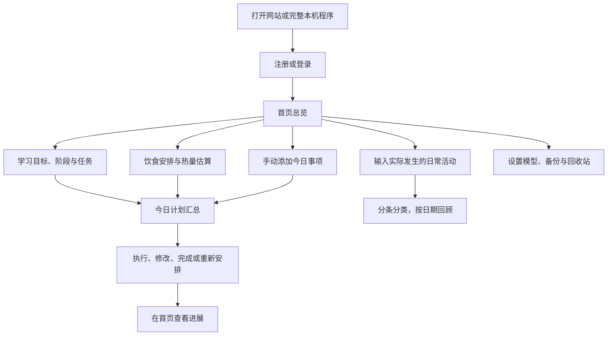

“今日计划”表示准备做的事情，“日常记录”表示实际发生的事情。填写日常记录不会自动勾选计划，也不会自动创建餐食安排。

## 3. 首页总览

入口：左侧“首页总览”。

- 查看当天事项、已完成数量、必要事项及完成率。
- 查看学习、饮食摘要，进入对应模块继续安排。
- 勾选事项表示完成，再次点击可撤销。
- 在快速备忘中记录临时想法，按需修改、删除或加入今日计划。
- 在日常记录区域补记活动，具体见第 7 节。

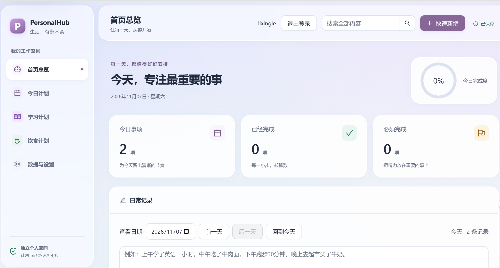

图 S02：首页包含今日事项、已经完成、必须完成和今日完成度，下方为按日期查看日常记录的区域。示例中当天有 2 项事项、0 项完成；画面未包含更下方的计划摘要及日常记录条目。

## 4. 今日计划

入口：左侧“今日计划”。

1. 选择需要安排的日期，点击“新增计划”。
2. 填写计划内容、日期、分组、优先级和备注，保存后显示在对应分组。
3. 根据需要放入“必须完成”“按时间安排”或“有空再做”。
4. 学习、饮食事项由来源模块关联到此处，可调整必要程度；修改具体任务或餐食时使用“编辑来源计划”。
5. 完成后勾选；未完成事项可“移到明天”。“结束今日”可填写总结并处理未完成事项。
6. 手动新增的事项可编辑或删除，误删后到回收站恢复。

示例：将“完成电路练习”放入“必须完成”，把“整理书桌”放入“有空再做”；午餐等来源事项仍保留饮食计划标识。

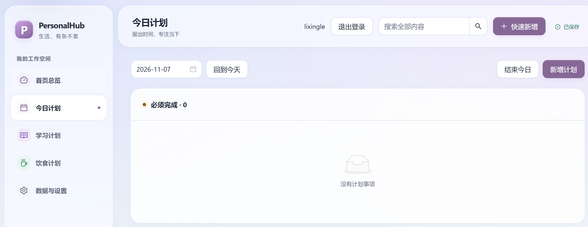

图 S03-1：选择日期后，可新增计划、回到今天或结束今日。“必须完成”在本示例中为 0 项，显示空状态。

查看今日计划的分组局部截图

图 S03-2：“按时间安排”显示 2 项；当前截图只有分组标题，未包含这两项的内容。

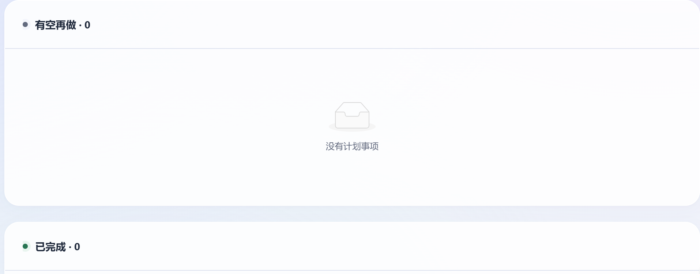

图 S03-3：“有空再做”为 0 项，下方可见“已完成”分组标题。

## 5. 学习计划

入口：左侧“学习计划”。

### 手动安排

1. 点击“新建学习目标”，填写主题、目标、日期和预计投入时间。
2. 在目标内建立章节或阶段，安排具体任务。
3. 任务填写执行说明、预计分钟、计划日期和所属阶段。
4. 点击任务旁“修改或删除”，可以编辑任务；所属阶段支持选择已有阶段或通过编辑窗口的阶段管理入口新增、修改。
5. 已排期任务关联到对应日期的今日计划。根据完成情况更新任务、阶段与目标进度。

目标还提供专注计时、“学习记录”和“笔记与资料”。专注计时用于记录实际投入；学习记录可补充笔记、问题与下一步安排。进度区域标明按章节计算或手动进度，手动调整后需保存。

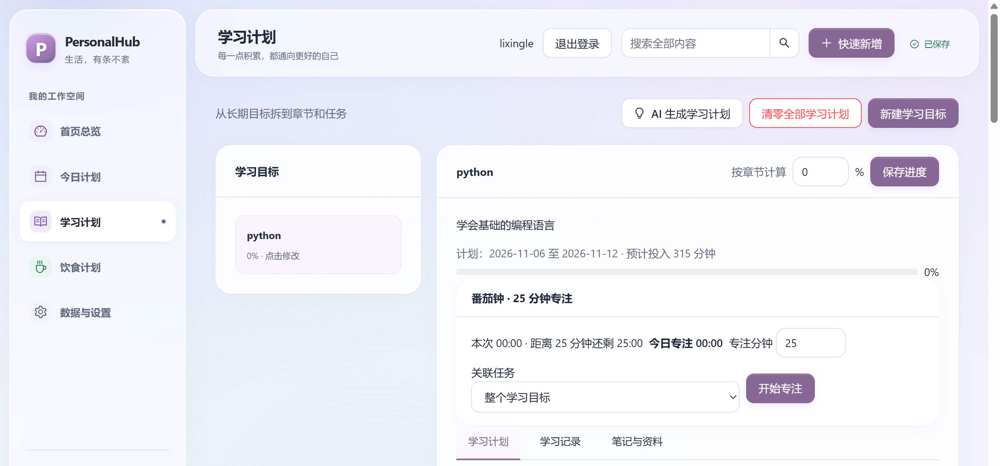

图 S04-1：以 Python 学习目标为例，展示目标说明、计划日期、预计投入、进度和番茄钟。可将专注关联到整个目标或具体任务；下方提供学习计划、学习记录、笔记与资料三个页签。

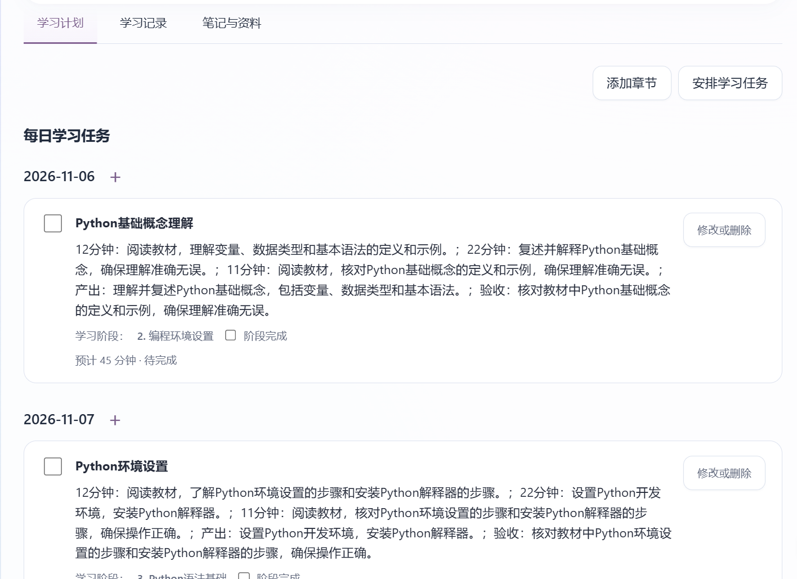

图 S04-2：学习任务按日期排列，每条显示执行说明、产出与验收文字、所属阶段、预计分钟和完成状态。通过“修改或删除”进入编辑；“添加章节”和“安排学习任务”用于继续拆分目标。图中内容为用户提供的示例，不表示已核验每条学习任务的专业质量。

### AI 辅助安排

填写主题、目标、当前基础、开始日期、天数和每日分钟，点击生成。先核对草稿中的阶段、任务、日期和时间，再确认加入正式计划；可先修改或移除不合适的任务。

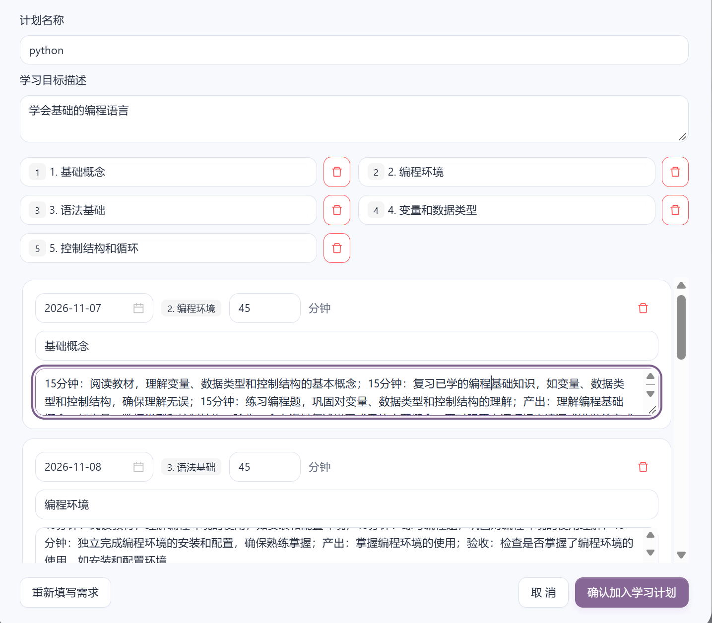

图 S06：生成后先编辑计划名称、目标描述和阶段名称，核对每条任务的日期、所属阶段、分钟与说明；不需要的阶段或任务可移除。点击“确认加入学习计划”才导入，或选择“重新填写需求”“取消”。预览内容应自行核对，尤其是任务名称与阶段归属是否一致。

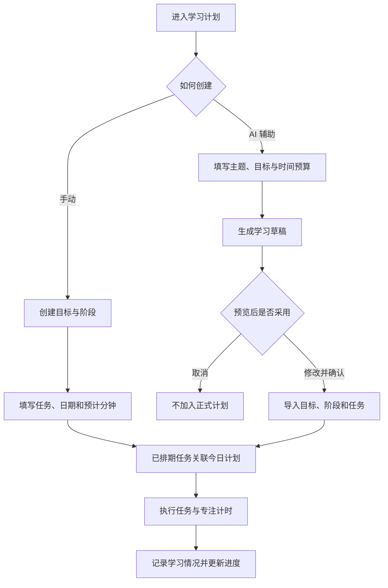

## 6. 饮食计划

入口：左侧“饮食计划”。

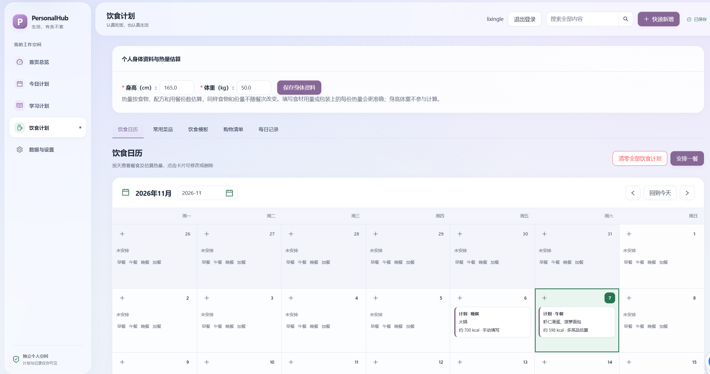

图 S07：饮食页面顶部为身体资料，下方提供饮食日历、常用菜品、饮食模板、购物清单和每日记录。日历中的餐食卡片显示餐次、内容与热量来源；示例分别展示“手动填写”和“多菜品估算”。可点击已有卡片修改，或使用“安排一餐”和日期格的加号新增。

### 安排一餐与估算热量

1. 在“饮食日历”选择日期和餐次，打开餐食窗口。
2. 可同时选择多道常用菜，也可在其他餐食输入框搜索菜名，逐行添加。
3. 已知用量时填写克数或份数，例如“米饭200g”“西红柿炒鸡蛋0.5份”。每行一种便于核对。
4. 查看逐项热量和整餐估算。全部菜品与输入餐食合计后，再乘本餐用餐份数；已填写实际用量时注意避免重复放大份量。
5. 如手动填写“这餐热量”，该值作为整餐总量，不再乘份数。
6. 保存后返回日历。点击已有餐食可修改或删除。

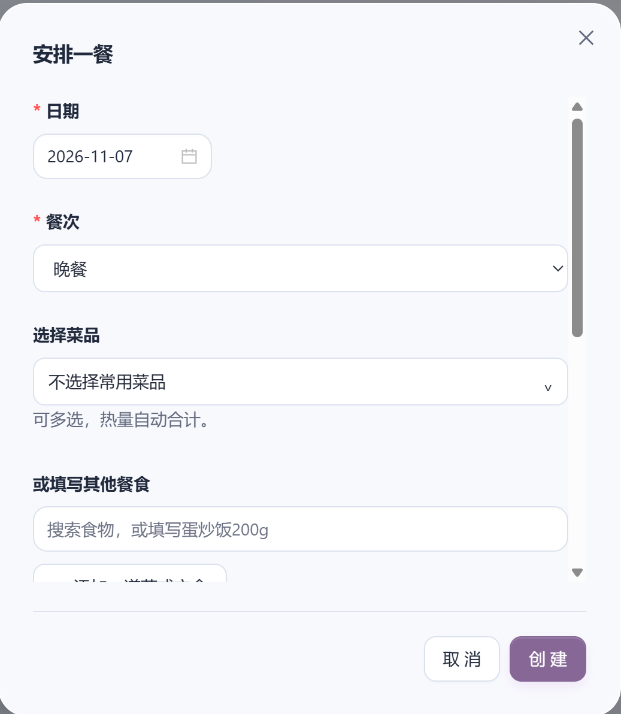

图 S08：先选择日期、餐次，再勾选常用菜品或搜索其他餐食，最后点击“创建”。这张图展示尚未输入食物时的安排入口，未展示热量明细。

参考热量来自食物数据和配方用量，不代表每家餐馆的实际做法。遇到“热量待补充”，先检查未识别项，可补充配方或填写实际整餐热量；已识别的部分不能当作整餐总量。详细口径见[热量估算说明](calorie-estimates.md)。

### 模板与购物清单

- “常用菜品”：维护菜名、食材用量、配方份数和每份热量，按自己的做法调整。
- “饮食模板”：复制或编辑周期菜单，选择开始日期和天数导入日历；也可先让 AI 生成草稿，再编辑、保存或导入。
- “购物清单”：按当前月份饮食生成，或新建空清单；物品支持添加、修改、删除，整份清单也可删除。
- “每日记录”：记录身体与日常感受等信息。身高、体重不参与菜品热量计算。

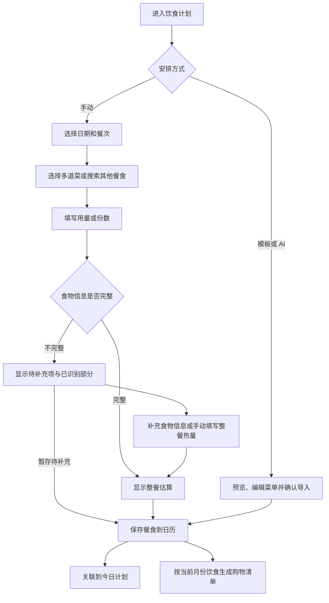

## 7. 日常记录

入口：“首页总览”内的“日常记录”。

1. 默认记录当天活动，也可先选择历史日期进行补记。
2. 输入实际做过的事情，例如“上午学习 MATLAB，中午吃了牛肉面，下午跑八百米”。
3. 点击“整理并记录”，系统分条保存，并按学习、饮食、运动等类别展示。
4. 同一天多次补记，同类型条目归到一起；每条仍可独立修改、删除和查看原始描述。
5. 分类不合适时手动修改；使用日期选择器、“前一天”或“回到今天”查看历史。

整理日常记录不依赖 Ollama。系统会提示明确的未发生或未来计划表述；含糊描述仍需自行核对。

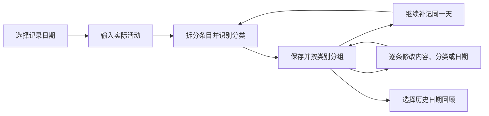

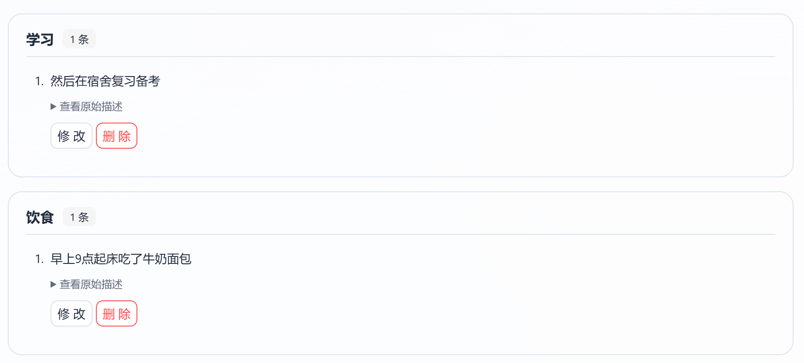

图 S09：已记录的活动按“学习”“饮食”展示，每组标明条目数量；每条可查看原始描述、修改或删除。当前示例各有 1 条，仅展示这两种分类。

## 8. 数据与设置

### 模型选择

进入“数据与设置 → 大模型”。不同运行方式显示的选项不同：

| 运行方式 | 操作 |
| --- | --- |
| 完整本机版 | 选择“内置模型”，或选择“其他本机 Ollama 模型”，填写本机地址、刷新列表、选择已下载模型并保存 |
| 多人共享网页版 | 选择“共享大模型”；如使用访问者本机模型，按页面说明允许网页来源和本地网络访问，再检查连接并保存 |

模型配置用于学习及饮食 AI 生成。内置模型无需另外下载；自选模型需先准备好。长计划和首次加载可能较慢，建议先用少量天数验证。当前切页后的任务恢复仍需专项验证，生成期间建议保留原窗口等待。

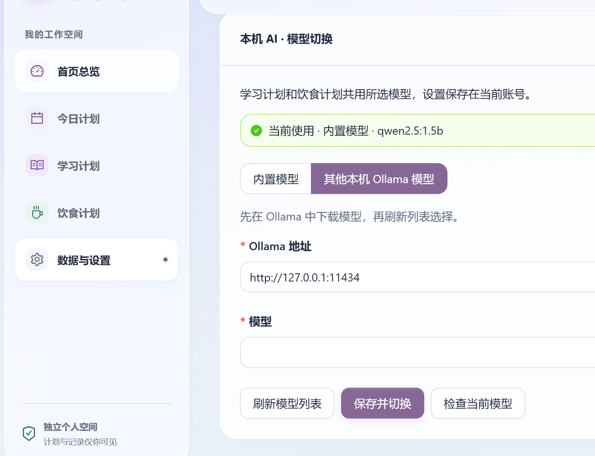

图 S10：顶部状态显示当前仍使用内置 `qwen2.5:1.5b`。下方虽已选中“其他本机 Ollama 模型”，但模型框尚未选择；需要刷新模型列表、选择已下载模型并点击“保存并切换”，才应用新选择。可用“检查当前模型”核对实际使用状态，不要把尚未保存的来源选项当作已经切换成功。

### 回收站与备份

回收站适合找回误删条目；恢复备份会将当前数据库替换为所选版本，二者用途不同。

1. 在“数据管理”查看回收站中的学习、饮食等大类。
2. 可恢复整个大类，或展开学习计划、购物清单等组，整组或逐条恢复。
3. 永久删除需确认，之后不能再通过回收站恢复该条目。
4. 点击“立即备份”创建当前数据副本。需要回到历史状态时，找到备份并选择“恢复此备份”。
5. 系统会在恢复前自动备份当前数据；恢复后核对计划、记录与模型连接情况。

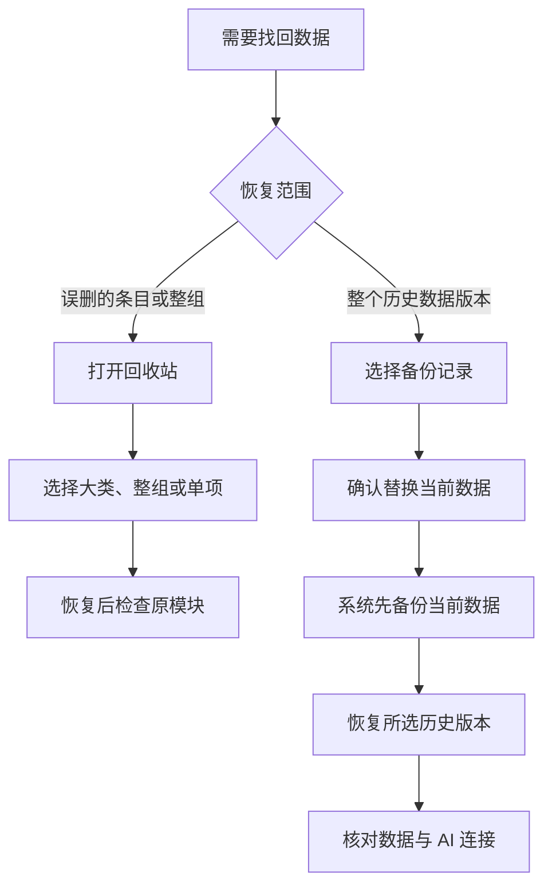

### 外观与当前限制

“个性化设置”可调整昵称、主题颜色和深色模式。当前已发现默认学习时长、每周起始日等偏好尚未完整应用到相关页面，不能将“设置已保存”视为相关功能已生效。

另有两项已知问题待修复：全局搜索尚未覆盖便签和日常记录；完整本机版恢复旧备份时，内置 AI 地址可能回退到旧端口。使用中遇到后者，可到模型设置重新检查配置。对应修复分别位于 `fix/search-coverage`、`fix/backup-ai-settings`；偏好修复位于 `fix/preferences`，本指南分支未包含这些修复。

## 9. 系统架构

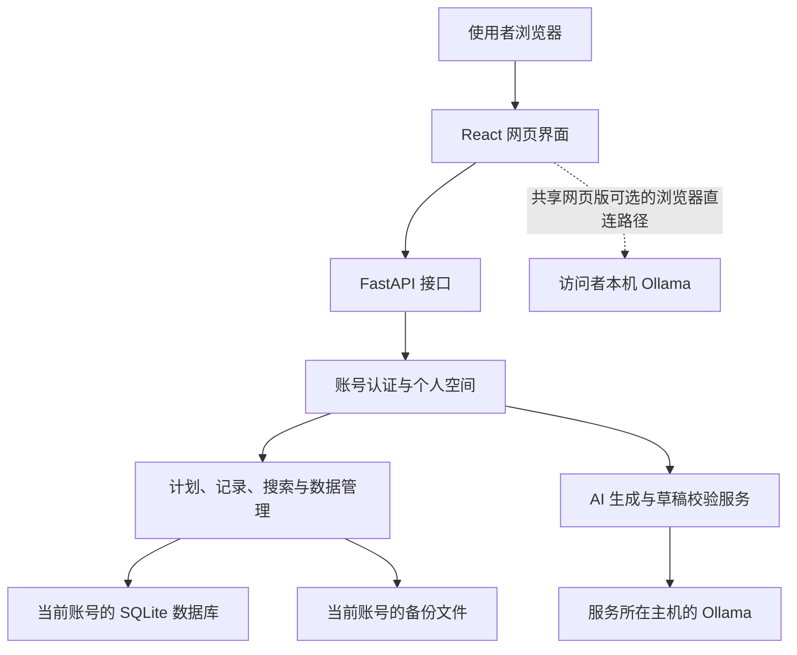

本机完整包将网页服务、数据库和内置模型运行在使用者电脑。多人共享方式将网页服务与账号数据集中在部署主机；共享模型也由该主机提供。图中的访问者本机模型路径为可选方式，不代表个人数据库会迁移到访问者电脑。

## 10. 常见问题与验证

| 情况 | 处理方式 |
| --- | --- |
| 本机程序未自动打开页面 | 查看程序窗口显示的网址；确认完整解压，保留 `ai` 和 `_internal` 文件夹 |
| 共享网址打不开 | 请部署者检查网站服务与隧道；临时隧道重建后应使用新网址 |
| 检测不到模型 | 确认所选模型来源、服务地址和模型已安装状态；访客直连方式还需检查网页来源与浏览器本地网络权限 |
| 生成较慢或失败 | 先减少计划天数，检查模型状态及页面错误；确认草稿内容后再导入 |
| 热量待补充 | 检查未识别的食物，补全配方或填写实际整餐热量 |
| 换电脑没有原数据 | 确认是否连接同一个共享服务；本机完整包默认各电脑独立保存 |

已有测试清单见[测试用例](TEST_CASES.md)
